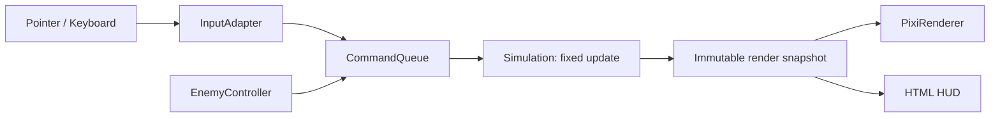

# SPLAT! — архитектура

Источник: [MASTER_SPEC §3](MASTER_SPEC.md#3-технологический-стек-и-архитектурные-ограничения), §4, §9 и задачи [PLAN](PLAN.md). Это спецификация будущей реализации: runtime и прототип на S−1 не создаются. `[A]` — утверждённая граница, `[P]` — непроверенная схема/число/деталь реализации, `[O]` — открытый выбор.

## Стек и доставка

| Слой | Предписанное решение | Назначение и граница |
|---|---|---|
| Язык | TypeScript strict | Типизированные домен, конфиг, команды |
| Графика | PixiJS | 2D WebGL/WebGPU; поддерживаемый fallback проверить по установленной версии на S0 |
| Сборка | Vite | Локальные dev/preview и статический production build |
| HUD | HTML/CSS поверх canvas | Подсказки, выбор, прогресс, Pause/Restart, итоги |
| Симуляция | Чистый TypeScript, fixed timestep | Без DOM, PixiJS и зависимости от render FPS |
| Unit/integration | Vitest | Инварианты, геометрия, команды и логика без графики |
| Browser smoke | Playwright | Старт, ввод, окраска/итог, Restart по доступности этапа |
| Качество | TypeScript strict, ESLint, Prettier | Типы, lint, форматирование |
| Версии исходников | Git + GitHub | Один репозиторий, ветки/PR этапов, принятый main |
| Хостинг | Vercel | Статический Vite build, preview веток/PR, production main |
| Backend | Нет | Нет серверной симуляции, API, БД и аккаунтов |

[A] Базовый стек TS + PixiJS + Vite + статический Vercel закреплён D-04; инструменты качества и тестирования заданы §3. Номера версий и lockfile выбираются на S0, сейчас не установлены. Без React, SSR, serverless-функций и Python в runtime. Независимые локальные скрипты для баланса/ассетов разрешены вне игры. Runtime GenAI запрещён; EnemyController — обычный детерминированный контроллер.

Локальный pipeline после S0: установка по lockfile при необходимости → проверки → `npm run build` → `dist/` → локальный preview статической сборки. Vercel: Vite preset либо Build Command `npm run build`, Output Directory `dist`. Это настройки из ТЗ, а не подтверждение существующего билда. Совместимость и актуальные параметры проверяются на S0. Секреты не требуются клиентскому gameplay и не попадают в исходники/отчёты.

GitHub → Vercel подключается с отдельного разрешения; S0 включает требование раннего preview, S7 — production-приёмку. Push/merge/remote/внешние аккаунты не разрешены фактом наличия этапа в плане. Без разрешения/доступа гейт деплоя остаётся открытым. На S−1 `.git` отсутствует; локальный workflow Git предстоит оформить на S0. WebSim необязателен и не хранит бизнес-логику.

## Поток данных и зависимости

Обязательная граница: Input → Commands → deterministic Simulation → Snapshot → Renderer/HUD. Детальная последовательность [P] из мастера:

Внутри update [P]: команды → movement → split/merge → combat → paint → outcome. EnemyController читает логические данные и подаёт команды тем же путём, не управляет рендером. InputAdapter переводит pointer в world с учётом viewport/resize; сырой ввод не меняет домен напрямую. HUD также отправляет намерения через команды/управление сессией. Камера и отображение не определяют логические размеры мира.

Чистое ядро не импортирует DOM/PixiJS, не читает часы браузера или неуправляемую случайность. Рендер не хранит авторитетные HP, членство групп или контроль клеток. Snapshot — immutable/render-only представление; конкретный способ защиты от мутаций [P] выбирается на S0. Нельзя менять эти границы ради удобства отдельного среза.

## Доменные структуры [P]

Начальная расширяемая модель перенесена из §3 без объявления реализованным API:

| Структура | Поля / назначение |
|---|---|
| Agent | `id, factionId, groupId, x, y, vx, vy, hp, alive` |
| Group | `id, factionId, agentIds, formation, target, command` |
| World | `width, height, obstacles, paintCells` |
| PaintCell | `control, owner` |
| GameCommand | `tick, type, payload` |
| MatchState | `phase, tick, result` |
| LevelConfig | `spawns, geometry, paint, winCondition, balancing` |
| EventLog | Упорядоченные логические события для диагностики; конкретная схема [P] |

Имена типов — исходная модель, не требование создавать пустые файлы. Snapshot, очередь и формат replay уточняются поэтапно; сериализация seed + команд должна позволять сравнить логический результат независимо от FPS (QA-08). Порядок команд одного tick, tie-break выбора целей и назначения слотов должен быть стабилен [P]. Недействительные команды безопасно отклоняются по явному правилу.

## Границы модулей и API [P]

Предлагаемые каталоги создаются только при соответствующей реализации, начиная с S0. Таблица задаёт контракты, не фиктивные готовые сигнатуры.

| Модуль | Вход | Выход / обязанности | Не допускается |
|---|---|---|---|
| `core/` | Конфиг, seed | Типы/ID, управляемый RNG, события и общие доменные правила | DOM/PixiJS, gameplay в HUD |
| `app/` | Команды сессии, конфиг, tick scheduling | Инициализация, fixed loop, Pause/Restart, владение сессией | Расчёт боя в draw callback |
| `input/` | Pointer/Keyboard, viewport, режим/выбор | Валидированные намерения, world-координаты и preview | Прямая запись в Agent/Group |
| `simulation/` | State, команды, fixed dt, конфиг/RNG | Следующий логический state, события, snapshot | Импорты рендера, зависимость от FPS |
| `simulation/formation`, `movement` | Полилиния, N агентов, цели | Фильтрация, слоты, стабильное назначение, ограниченное движение | Телепорт, CFD, сложный pathfinding первой карты |
| `simulation/groups`, `splitMerge` | Членство, выбранные группы, команды | Атомарное корректное перераспределение, удаление пустых групп | Дубли, потеря живых, автоматический разрыв без решения |
| `simulation/combat`, `paint`, `objectives` | Логические расстояния, HP, клетки, конфиг | Урон/потери, влияние/owner, единственный outcome | Двойная атака, пересчёт исхода после завершения |
| `enemy/` | Логическое наблюдение, tick/конфиг | Детерминированные команды охраны/движения/реакции | ML/GenAI, управление PixiJS |
| `rendering/` | Snapshot, viewport, статичные ассеты, preview | Pixi scene, units, paint, overlays | Изменение симуляции, постоянные move-particles |
| `ui/` | Snapshot, режим ввода/сессии | HUD/help/results и команды пользователя | Собственный авторитетный gameplay-state |
| `content/` | Ручная конфигурация уровня | Геометрия, spawns, баланс, цель | Runtime-генерация карт |
| `tests/` | Фикстуры, seed, журнал команд | Unit/integration/browser smoke согласно QA | Зависимость unit-ядра от DOM/PixiJS |

Статичные одобренные ресурсы — будущий `public/assets/`, а moodboard остаются только в `docs/design/references/`. `index.html`, конфиги TS/Vite, package/lockfile появятся на S0; `src/`, `tests/` и `public/assets/` на Bootstrap не созданы.

## Обязательные инварианты

1. ID всех агентов уникальны.
2. Каждый живой агент ровно в одной существующей группе своей фракции.
3. Списки групп без повторов и в совокупности равны множеству живых агентов.
4. Split/merge не меняет число живых; потери только от боя.
5. Пустые группы удаляются, группа из одного агента не делится.
6. Outcome единственный; после итога игровое состояние не продолжает изменяться от влияния/команд матча.
7. Restart создаёт логически идентичный начальный state, а не переставляет старые объекты.
8. Рендер не меняет состояние симуляции.

S0 проверяет ID/членство/Restart/fixed steps; S2/S3 — split/merge; S4 — owner/outcome; S5 — потери и replay. Смерть при merge на S3 проверяется модельной фикстурой, combat остаётся в S5. Полные критерии — [QA](QA.md).

## Конфигурация и непроверенные параметры [P]

- Fixed timestep начально 1/60 с; ограничить догоняющие шаги, проверить поведение на разных FPS. Seed и журнал команд сохранять для воспроизводимости, Restart сбрасывает связанные таймеры/очереди по явному правилу.
- Размер мира, масштаб/камера, число отрядов, скорость, радиусы разведения и дистанция merge не утверждены (D-10).
- Геометрия полилинии, фильтрация соседних точек, максимальные точки/длина и правила после split/merge конфигурируемы и проверяются S1–S3.
- Окраска: grid или именованные зоны; скорость/радиус присутствия, owner/control, насыщенность, пороги и победная доля из LevelConfig (D-08).
- Бой: радиус, выбор ближайшей цели, HP, cooldown, урон; один удар за атаку, удаление при HP≤0, синхронизация групп/HUD (D-09).
- Событийные эффекты, их частота/детализация и возможность отключить дорогие эффекты — конфиг S5/S6, без непрерывных частиц движения.

Не заменять конфиг магическими константами; настройка гипотез не превращает их в Approved. Автоматический разрыв от натяжения остаётся Open D-06, до решения не реализуется.

## Производительность и проверка

Базовый набор — 40 синих агентов; дополнительные стресс-тесты на нескольких десятках — [P] из мастера, конкретный состав нагрузки уточняется при измерении без нового утверждённого лимита. Ориентир [P] — 60 FPS на обычном ноутбуке, допустимость 30 FPS в нагрузке проверить инструментально. Цели — актуальные стабильные Chrome/Chromium и Firefox desktop. Характеристики устройства, сценарий, размер viewport и результаты замеров должны быть записаны при фактической проверке.

Масштаб рендера независим от окна, pointer mapping корректен после resize; большие группы и границы контроля читаемы. Измерять прежде оптимизации, снижать дорогие эффекты при необходимости. Детерминизм проверять seed + журнал команд при разном числе render frames; не сравнивать визуальные кадры как логический state. На S−1 FPS, браузеры, сборка и игровые тесты не проверялись.
