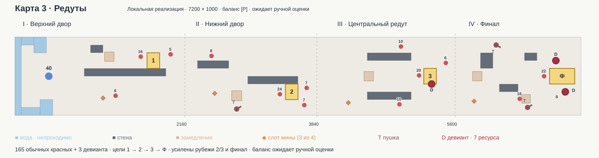

# Карта 3 — «Редуты» [P]

> **Актуальная приёмка, 11.11.2026:** заказчик принял все пункты плана и текущий финальный продукт в опубликованном виде. Более ранние статусы ожидания приёмки ниже — исторические записи на момент соответствующих действий. Это решение не означает, что ранее не выполненные проверки были запущены, и не утверждает автоматически отдельные открытые решения или нереализованные первоначальные варианты. [Текущий статус](STATUS.md).

11.11.2026. **Схема согласована заказчиком для реализации; уровень реализован локально и ожидает ручной оценки.** Заказчик поручил подробную схему третьей карты с прежними механиками и продвижением вправо, затем сообщил «отлично, приступаем к реализации этой карты». Ниже сохранён проект с уточнениями по коллизиям и безопасным площадкам. Числа баланса остаются [P]. Фактическая реализация и проверки — в [отчёте](REDOUBTS_REPORT.md).

**Уточнение после ручной игры:** заказчик попросил усилить рубежи 2/3 и финал и указал на пассивность девианта при нижнем захвате. Текущая расстановка ниже обновлена: 165 обычных, 3 девианта, 3 пушки; девиант третьего рубежа стоит у самой точки. Первоначальная настройка 135+2/две пушки и её результаты сохранены в отчёте первой реализации. [Текущие проверки и баланс](REDOUBTS_BALANCE_REPORT.md). Это пробная настройка, ожидающая ручной оценки.

## Характер прохождения

«Два прохода» строится вокруг поперечных преград, «Излучина» — вокруг обходов водоёмов. «Редуты» предлагает последовательный штурм отдельных дворов: протяжённые горизонтальные стены разделяют подходы, но не перекрывают карту поперёк. Можно обойти стену, выманить ближайшую группу и атаковать рубеж с другого направления. На каждом участке есть место для перестроения и возвращения к соседнему проходу.

Три промежуточных рубежа и финальная точка. Порядок — верхний двор → нижний двор → центральный редут → открытый финал. Движение остаётся вправо; переход между дворами не требует возвращаться в предыдущий сектор. Малые группы уже стоят в глубине обороны и реагируют по действующим правилам. Новые волны, скрытый спавн, таймер удержания, одновременный захват, ключи, новые типы врагов и редактор не нужны.

Предлагается **7200×1000**, сетка **90×10**, прежние клетки 80×100. Старт — 40 синих в (430, 500), прежние здоровье, скорость, разделение, объединение, движение кликом и пополнение. Общие параметры оружия, девиантов и ловушек берутся из текущей игры. Размер увеличен на 20% относительно обеих существующих карт. Цель длительности первой осмысленной партии — 3–5 минут; это ориентир до проверки, не измеренный результат.

## Цели и камера

Координаты прямоугольников: `(x, y, ширина, высота)`, начало координат слева сверху. Все цели выровнены по клеткам и не перекрываются препятствиями.

| Цель | Прямоугольник | Ограничение камеры до захвата (`viewEnd`) | Причина расположения |
| --- | --- | --- | --- |
| Рубеж 1 | (1680, 200, 160, 200) | 2160 | Верхний двор за длинной горизонтальной стеной |
| Рубеж 2 | (3440, 600, 160, 200) | 3840 | Нижний двор, два направления подхода |
| Рубеж 3 | (5200, 400, 160, 200) | 5600 | Центр после отдельного боя с девиантом |
| Финал | (6800, 400, 320, 200) | После рубежа 3 доступна вся карта | Просторная площадка, вход сверху, снизу или по центру |

Каждый рубеж занимает 4 клетки, финал — 8. Используется существующее оформление точек: рамка, номер, стрелка, переход в синий после захвата. Прямые текстовые подсказки не добавляются. Камера сохраняет текущие перекрытие, плавность и защиту от дёрганья; меняются только границы из конфигурации уровня.

Победа — последовательный зачёт трёх рубежей и синяя финальная точка, при наличии живых синих. Рубежи засчитываются на матч, финал проверяется по текущей окраске. Общий процент территории остаётся статистикой. Никакой зачистки всей карты или обязательного возвращения за пропущенными клетками.

## I. Верхний двор: выбор направления, x = 0–2160

После стартовой площадки горизонтальная стена тянется от x=880 до x=1920 на y=400–500. Над ней — просторная дорога к первому рубежу. Снизу — длинный обход к правому торцу, откуда можно зайти в верхний двор с тыла. Между торцом стены и текущей границей камеры остаётся 240 единиц; там потребуется вытянуть строй или разделить группу. Верхняя дорога шире.

- **Прямой вариант:** пройти сверху, обойти квадрат замедления, атаковать 16 защитников перед рубежом. По мере продвижения к точке реагируют 5 бойцов из глубины двора.
- **Обход:** пройти снизу, решить бой с отдельной группой из 6, затем подняться за правым торцом стены. Этот путь длиннее и имеет один видимый кандидат мины; можно идти вокруг него.
- **Тактический вариант:** небольшой группой выманить верхний гарнизон влево, основными силами обойти торец и занять двор. Это возможность для проверки, не обязательный рецепт победы.
- После захвата — свободная площадка x=2000–2200, y=480–820 для объединения и пополнения. Рубеж не лечит и не выдаёт ресурс автоматически.

Начало содержит берег слева, короткий верхний блок и длинную стену, но первая угроза не достаёт старт. Сначала игрок видит развилку и цели, затем вступает в бой.

## II. Нижний двор: артиллерия и обход, x = 2160–3840

Короткая верхняя стена и длинная стенка над нижним рубежом образуют два подхода к одному двору. Пушка в (2820, 920) простреливает часть короткой нижней дороги. Верхний обход проходит вне её текущей дальности, но охраняется отдельной группой из 8. В районе x=3640–3840 сохраняется место для спуска к точке справа от стены.

- **Короткий путь:** двигаться снизу, обходя пятно замедления в зоне огня, затем атаковать 24 защитников. Риск выше, расстояние меньше.
- **Широкий путь:** пройти выше пушки, победить или отвлечь верхнюю восьмёрку и зайти к нижнему двору справа.
- Две поддержки по 7 стоят за основным гарнизоном на разных высотах. Их зоны реакции позволяют пробовать вытянуть одну группу, не поднимать сразу всех троих.
- Пушка не должна доставать сам рубеж. Её обход возможен без ожидания удачного случайного события. Стены блокируют дробь согласно текущему коду; отдельно проверить, что выбранная стенка действительно перекрывает конкретную траекторию.
- После точки — площадка x=3760–4000, y=300–650; на ней можно пополниться перед следующим боем.

## III. Центральный редут: девиант перед целью, x = 3840–5600

Две горизонтальные стены сверху и снизу образуют центральный коридор высотой 400 единиц. Стены заканчиваются до рубежа, поэтому доступны верхний и нижний обходы и общий двор справа. После замечания заказчика первый девиант перенесён из (4800,500) в (5300,600), к нижнему краю самой точки. Он защищает её и при нижнем обходе; прежний пост не доставал до захватывающих бойцов из-за радиуса и предела преследования.

- **Штурм:** девиант вступает вместе с обороной точки. Для отдельного боя его можно выманить к нижнему правому подходу; основной гарнизон остаётся слева, поддержка — сверху. За его гибель сразу поступают 7 ресурса; при потерях можно нажать R и восстановить до двух бойцов, оставив 2 ресурса.
- **Фланговый вариант:** обойти стену сверху или снизу, встретив отдельную десятку. Можно попробовать отвлечь девианта небольшой группой с нижней правой стороны, основными силами выйти к рубежу с фланга.
- 20 обычных красных защищают точку, ещё 6 стоят справа сверху и вступают при сближении. Можно разделить бои по направлениям, однако сам рубеж теперь защищён девиантом.
- Награда за девианта — полезный выбор; прохождение без неё должно оставаться возможным. Прямого требования убить всех красных нет.
- После захвата — площадка x=5520–5800, y=200–480, без мин и огня пушек.

## IV. Разомкнутый финал, x = 5600–7200

Несколько отдельных блоков оставляют три связанных подхода. В отличие от узкого штурма рубежей здесь можно менять направление атаки без движения назад через длинную стену.

- Нижний подход защищают 16 обычных красных. Центральный гарнизон из 22 стоит перед финальной точкой. Восьмёрка из глубины прикрывает её нижний край.
- Два девианта стоят сверху и справа снизу от финала, в (6880,300) и (7000,700). Они прикрывают разные части цели; можно выманивать их по очереди или пробовать отвлечение.
- Верхняя пушка находится существенно раньше финала. Новая нижняя пушка в (6520,900) прикрывает нижний подход вместе с боковым постом. Ни одна не достаёт до клеток самой цели или площадки пополнения; центральный обход остаётся вне дальности пушек.
- Финал не запирается в тупике. Между верхним, центральным и нижним направлениями остаются широкие поперечные связи.
- Внутри цели и непосредственно у входов нет мин и замедления. Последняя задача — бой, манёвр и окраска 8 клеток, а не переносимость урона от неуязвимой пушки.

## Черновое размещение непроходимых областей

Геометрия фиксирована. Не добавлять случайные стены поверх этих проходов в первой реализации. Стены и вода непроходимы и не окрашиваются, видимая граница совпадает с коллизией. Берег слева составлен из соединённых прямоугольников, без прямой линии берега по всей высоте.

| Тип | Прямоугольники |
| --- | --- |
| Стартовая вода | (0,0,80,1000); (80,0,160,100); (80,900,240,100); (240,0,160,200); (320,800,160,200) |
| Стены I | (880,400,1040,100); (960,100,160,100) |
| Стены II | (2320,300,400,100); (2960,500,640,100) |
| Стены III | (4480,200,560,100); (4480,700,560,100) |
| Стены IV | (5920,200,160,200); (6160,600,240,100); (6480,200,160,100) |

Целевые ширины основных маршрутов — 240–400 единиц и больше; на нескольких поворотах 240. Это проектный запас, а не доказанная проходимость. При проверке учесть размер маркера, отступ коллизии, строй из 40, разделённые группы, построение красных и радиус увеличенного девианта. Если требуется теснить весь отряд в одну точку или маршрут зависит от точного пикселя клика, расширить проход до повышения силы врага.

## Черновая ведомость противников

Все координаты — центры постов, численность фиксирована. Число колонок выбирается в конфигурации так, чтобы исходный строй не пересекал стену, воду или другой пост.

| Участок | Пост | Число | Центр | Роль |
| --- | --- | --- | --- | --- |
| I | Гарнизон | 16 | (1600,250) | Верхний вход к рубежу |
| I | Поддержка | 5 | (1980,220) | Ответ на попытку занять точку |
| I | Боковой пост | 6 | (1280,750) | Нижний обход |
| II | Гарнизон | 24 | (3370,730) | Нижний двор |
| II | Поддержка A | 7 | (3710,650) | Верхний угол за точкой |
| II | Поддержка B | 7 | (3680,870) | Нижний угол за точкой |
| II | Боковой пост | 8 | (2500,240) | Длинный безопасный обход пушки; сдвиг на 20 от стены сохраняет отступ построения |
| III | Девиант | 1 | (5300,600) | Защищает сам рубеж, включая нижний подход |
| III | Гарнизон | 20 | (5140,490) | Центральный рубеж |
| III | Поддержка | 6 | (5480,330) | Правый край двора |
| III | Верхний пост | 10 | (4910,120) | Верхний обход |
| III | Нижний пост | 10 | (4890,860) | Нижний обход |
| IV | Нижний пост | 16 | (6420,790) | Нижний вход в финал |
| IV | Гарнизон | 22 | (6730,500) | Центр перед финалом |
| IV | Поддержка | 8 | (6990,720) | Нижняя глубина цели |
| IV | Верхний девиант | 1 | (6880,300) | Верхняя часть финала |
| IV | Нижний девиант | 1 | (7000,700) | Нижняя правая часть финала |

Итого **165 обычных + 3 девианта = 168 красных**: 27 / 46 / 47 / 48 по участкам с учётом девиантов. Первоначальная настройка была 135+2, но ручная оценка заказчика сочла второй, третий рубежи и финал слишком лёгкими. Первый участок не усиливался. Для сравнения в «Излучине» 150 обычных и 2 девианта.

Начальные гипотезы `localDefense`: гарнизоны radius=280, leash=180; поддержки 230/170; боковые посты 250/160. Девианты используют общие текущие параметры: 20 HP, скорость ×1.5, дальность атаки 50, интервал 30 тиков, реакция 320, предел преследования 240. Препятствия не отключают реакцию по расстоянию: контроллер сейчас не проверяет видимость. Поэтому раздельный вход в бой подтверждать в модели, а не считать гарантированным стеной.

## Опасности и воспроизводимость

- Три пушки: (2820,920), (6120,100), (6520,900). Прежний постоянный огонь и разворот на 180°, без изменения урона/дальности/темпа ради новой карты.
- Пять квадратов замедления: центры (1200,250), (2820,750), (4500,500), (5880,500), (6500,790); полустороны 60, 64, 60, 60, 55 соответственно. Размеры — гипотезы.
- Четыре кандидата мин: (1120,780), (2540,720), (4240,840), (5840,820). Через seed выбираются 3 из 4. Каждое место открыто для обнаружения, существует обход.
- Все варианты выбора мин проверить: ни радиус урона, ни красная окраска на 3 клетки в каждую сторону не затрагивают обязательную цель или безопасную площадку пополнения. Окраска мины значительно шире радиуса урона — учитывать оба ограничения отдельно.
- Геометрия, посты и цели не рандомизируются. Seed фиксируется в LevelConfig и повторяется при Restart; при реализации назначен 20261112. Это идентификатор генерации, не дата выпуска. Seed существующих карт не менялись.
- Мин и опасностей нет на старте. Не накладывать неизбежный огонь пушки на единственный путь к цели. Замедление около пушки — сознательный риск короткого обхода, рядом должна проходить безопасная дорога.

## История: расчёт баланса до первой реализации [P]

Расчёт ниже относится к первоначальным 135 обычным и двум девиантам. После запроса усиления полный ресурс за всех врагов составляет 165 + 3×7 = 186; это теоретический максимум, а не обязательная награда маршрута. Новые прохождения и расход подкреплений приведены в REDOUBTS_BALANCE_REPORT. Старый расчёт сохранён как история проектирования.

Награда обычного красного — 1, девианта — 7. Пополнение стоит 5 и возвращает до 2 синих при общем лимите 40. Лечение живых бойцов отсутствует. При одном свободном месте полная цена 5 даёт только одного; запас ресурса не равен автоматически восстановленному здоровью армии.

| Участок | Ориентир побеждённых обычных на боевом маршруте | Ресурс с девиантами | Ориентир потерь для первой настройки |
| --- | --- | --- | --- |
| I | 21–27 | 21–27 | 4–6 |
| II | 28–36 | 28–36 | 6–9 |
| III | 20–36 и 1 девиант | 27–43 | 7–10 |
| IV | 22–36 и 1 девиант | 29–43 | 7–10 |

Это предполагаемый маршрут с боями, **не обязательное число убийств по правилам**, не измеренные потери и не обещание сложности. Без убийства девианта соответствующая награда меньше на 7; маршрут отвлечения тоже должен быть жизнеспособным.

На таком боевом маршруте получается 105–149 ресурса; верхняя граница — уничтожение всех врагов. Это теоретически 21–29 полных покупок, до 42–58 новых бойцов за всю партию при постоянных потерях и свободных местах. Ожидаемые потери по четырём участкам — ориентир 24–35, но доступность пополнения **во время** боя важнее итоговой суммы: награда за позднего противника не спасёт уже проигранный предыдущий бой.

После первой пары гарнизонов игрок должен иметь шанс восстановить потери перед следующим участком. Перед девиантом нужен живой маневренный отряд, а после него — окно для R. Цель ручного баланса: обычная осторожная партия заканчивается с 24–36 бойцами, уверенное использование обходов — с большим запасом. Это критерий настройки, не полученный результат. Лобовой штурм всех постов подряд может закончиться поражением, но один неудачный поворот не должен делать остаток карты безнадёжным.

Сначала регулировать места и радиусы реакции, чтобы гарнизоны вступали раздельно. Затем менять обычные группы шагами по 2 бойца. Общую силу девиантов, стоимость R и скорость окраски не менять ради одного уровня без отдельной оценки регрессий обеих существующих карт. Не добавлять скрытое ослабление противника или выдачу ресурсов по таймеру.

## Порядок реализации и ручной гейт

1. Схема, размер и три рубежа согласованы для реализации 11.11.2026. Карта добавлена в каталог и меню. Это не приёмка результата или утверждение окончательной сложности.
2. Добавить отдельный LevelConfig: геометрия, цели, посты, безопасные слоты опасностей. Использовать существующие механики, минималистичный вид и B-static; не менять первые две карты.
3. Проверить связность маршрутов с учётом отступа коллизии, все четыре варианта мин, исходные построения, покрытие целей сеткой и границы камеры. Проверить возможность зайти к каждому рубежу с двух направлений до его открытия.
4. В модели пройти концентрированным отрядом и со split/обходом. Зафиксировать по участкам потери, ресурс, применение R, время, порядок вступления постов и обе встречи с девиантами; воспроизвести журнал команд.
5. Проверить победу, поражение, Restart, меню, переход со второй карты, обучение и регрессии первых двух карт. Проверки с отчётами выполнять во временной копии.
6. Показать локальную сборку. Получить ручную оценку выбора пути, читаемости целей и комфортности финала. Автотесты не принимают дизайн и баланс за человека.

Ручной чеклист будущей карты: оба подхода к каждому рубежу видны; не требуется закрашивать пройденные области; поддержку можно отвлечь отдельно хотя бы на одном подходе; первый девиант вступает до финала; обе награды видны в HUD; R полезна между боями; нет обязательной остановки под пушкой; после третьего рубежа финал достижим сверху и снизу; камера не требует скрытого клика за её границей; проигрыш и повтор начинают чистую партию.

Уточнения реализации: три площадки пополнения ограничены так, чтобы их не пересекала даже окраска мин на 3 клетки, а не только радиус урона. Исходный проект располагал их в x=2000–2280/y=480–820, x=3760–4120/y=300–650 и x=5520–5840/y=350–650. Геометрия стен и целей не менялась. Модельные маршруты показали победу концентрированной армией и через split/merge; неудачная несогласованная атака половинами также сохранена в отчёте. Комфортность прохождения оценивает человек.
